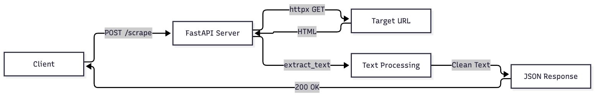
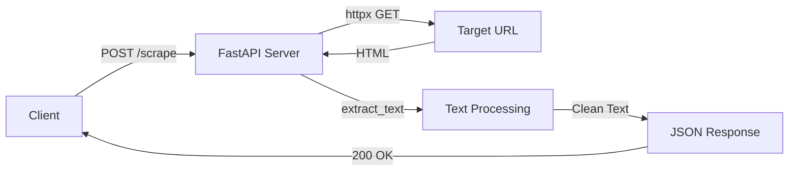

# Scrubnet

Convert raw web pages into clean, LLM-ready Markdown

# WebScraper MVP

A minimal web scraping service using FastAPI.

## Usage

1. Install dependencies: `pip install -r requirements.txt`
2. Run server: `python -c "from main import demo; demo()"`
3. Test: `pytest -q`

## API

POST /scrape
Body: { "url": "https://...", "max_length": 1000 }

## Architecture

Mermaid source

